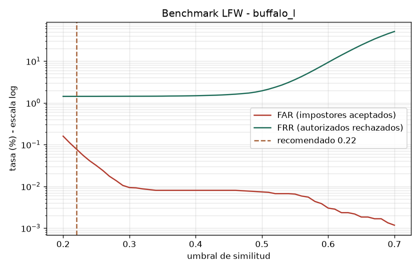

# Handtracker — visión por computadora con Python

Tres aplicaciones de cámara en tiempo real, construidas con OpenCV, MediaPipe e InsightFace.

| App | Qué hace |
|---|---|
| `control_acceso.py` | **Control de acceso por reconocimiento facial.** Solo pasan personas enroladas, autorizadas, vigentes y con consentimiento registrado. |
| `fichaje.py` | **Fichaje facial** de entrada y salida de empleados, con reporte exportable en CSV. |
| `hand_tracker.py` | **Demo interactiva:** la distancia entre tus manos revela un texto letra por letra, con partículas, pixelado de caras y grabación de video. |

## Control de acceso facial

- **Reconocimiento:** InsightFace (`buffalo_l`) genera un embedding de 512 dimensiones por rostro; la identificación es por similitud coseno.
- **Prueba de vida:** detección de parpadeo con MediaPipe Face Landmarker, asociada a la cara reconocida por IoU. Una foto no abre la puerta.
- **Umbral calibrado con datos**, no a ojo: `benchmark_lfw.py` evalúa el modelo sobre el dataset público LFW (2.308 identidades).

  | Umbral | Falsa aceptación (FAR) | Falso rechazo (FRR) |
  |---|---|---|
  | 0,35 | ~0,008 % (≈ 1 en 12.500) | ~1,4 % |

  

  El script sugiere 0,22 por defecto, pero para control de acceso se eligió 0,35: el falso rechazo se mantiene en ~1,4 % y la falsa aceptación baja unas 10 veces. Preferimos molestar a un autorizado antes que dejar pasar a un impostor.

- **Privacidad:** se guardan embeddings, nunca fotos. La base biométrica se cifra en reposo con Fernet (`cripto.py`), con la clave fuera del código (variable de entorno `ASISTRA_KEY`).
- **Auditoría:** cada intento queda registrado (quién, cuándo, resultado).
- **Hardware:** hook `abrir_puerta()` listo para conectar un relé o cerradura eléctrica.

> No es vigilancia: no identifica desconocidos ni arma listas de personas que no dieron su consentimiento.

## Instalación

```bash
python -m venv .venv
.venv\Scripts\activate          # Windows
pip install -r requirements.txt
```

La primera ejecución descarga el modelo `buffalo_l` de InsightFace (~300 MB). Los modelos de MediaPipe (`*.task`, `*.tflite`) vienen incluidos.

Para el control de acceso, generá la clave de cifrado una sola vez:

```bash
python generar_clave.py
```

## Uso

```bash
python control_acceso.py   # e: alta · l: listar · r: baja/reactivar · q: salir
python fichaje.py
python hand_tracker.py     # n/p: cambiar palabra · f: pixelar caras · q: salir
```

## Datos

Ningún dato personal se versiona: registros de accesos y fichajes, altas de personas, embeddings y fotos están excluidos en `.gitignore`.

## Pendiente

- Migrar `fichaje.py` al mismo cifrado en reposo que usa el control de acceso (hoy guarda sus datos sin cifrar).
- Tests automatizados.

## Stack

Python · OpenCV · MediaPipe · InsightFace · ONNX Runtime · NumPy · cryptography
